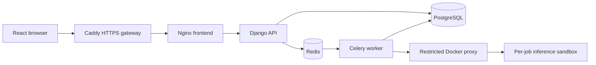

# Team 13 SRS, SAD and Test Plan update
Version 1.1 | 9 November 2026 | Prepared for final review

## 1. Purpose, scope and references
This amendment updates the implemented behavior and validation procedure of the approved
`Team13_SRS_SAD_STP.pdf` Version 1.0. Requirement IDs, actors and module ownership remain the
traceability anchors. Read this update with the original IEEE-structured document and the
final execution reports. The final-demo FAQ permits explained Agile deviations. Changes
below identify those deviations explicitly for the viva.

## 2. Updated SRS behavior
| Reference | Final behavior | Verification |
| --- | --- | --- |
| FR-005/006 | React history supports status/task/date filters, paging, compatible selection, and confirmation before deletion | Browser ST-AUTH-02 and backend history/deletion tests |
| FR-007, SEC-008, BR-05 | The workspace evaluator can read current members' workspace evaluation details, status, charts and reports; deletion stays owner-only | Workspace read, membership-revocation and owner-deletion regressions |
| FR-014 | A member or evaluator can choose an accessible workspace when submitting their own validated pair | Available-workspace API, submission checks and browser upload controls |
| FR-022 | React renders classification/regression charts; ROC class is selectable | Browser result/ROC checks and metric/chart contract tests |
| FR-023..027 | Compare 2-5 successful owned runs on the same checksum, target column and task; highlight winners and export reports | Comparison API tests and browser history comparison |
| UC-12, API-23, UI-08 | ADMIN can search accounts, activate/deactivate them and inspect security audit events | Admin API security tests and browser administration scenario |
| NFR-010 | Hourly purge uses the configured retention period; deleting the last referencing evaluation also removes its uploads | Shared-input, retention and rollback regression tests |

### 2.1 Role-policy deviation
ADMIN retains the existing evaluator capabilities for workspaces it owns and normal USER
capabilities for its own runs. It receives no general access to another user's uploads or
results. This supersedes the restrictive ADMIN cells in original STP Section 11.1. Ordinary
USER accounts still receive 403 on management functions. Read access to a workspace member's
run requires both the evaluator relation and current membership. This policy preserves the
implemented hierarchy and is covered by tests; explain it during the viva.

### 2.2 Clarifications
A comparison also requires the same target column, since the same CSV may contain several
candidate labels. Shared uploads survive deletion of one run while another run references
them. Physical file removal occurs after a successful database commit, preserving files on
transaction rollback. The original `evaluations.purge_expired_files` entry point delegates
to the same retention implementation as the hourly ingestion task.

## 3. SAD implementation update
The React application now covers registration, upload/target/compatibility, queued/running
status, results, history/comparison, workspaces and administration. The Django `/results`
dashboard remains available as the earlier reporting surface. The normal React workflow
completes on one browser origin without a separate dashboard login.

Concurrent requests share one token-refresh operation. A stale refresh cannot restore a
signed-out session, and expired sessions return to sign-in. Async upload controls prevent
input changes during a request. The sandbox now uses a dedicated `/sandbox-tmp` tmpfs with mode 0700 and matching
UID/GID, and verifies the daemon-reported mount and working directory before execution.
This replaces the earlier generic `/tmp` location. Labels and trusted scoring remain
outside the container as specified by the original SAD.

The optional `compose.https.yml` adds Caddy in front of Nginx and Django. Public ingress is
limited to the gateway; Django receives a trusted HTTPS scheme and enforces redirects and
HSTS. Local HTTP is the demo configuration. Actual public deployment needs the operator's
hostname, DNS and allowed-host settings.

### 3.1 Updated deployment and interaction model

The gateway is enabled by the HTTPS override. Local demo traffic enters Nginx directly.
Metric scoring and labels remain in the trusted worker. The approved sequence diagrams
still define upload/validation and evaluation, with the new browser routes calling those
same API contracts.

## 4. API contract additions
| Method | Endpoint | Contract / authorization |
| --- | --- | --- |
| GET | /api/v1/workspaces/available | Authenticated caller's memberships and managed workspaces; array for the upload selector |
| GET | /api/v1/admin/users?q=&page= | ADMIN-only paginated account search; hashes/tokens omitted |
| GET | /api/v1/admin/audit?page= | ADMIN-only paginated security events |
| GET | /api/v1/evaluations/{id}, /status, /charts, /report.json, /report.pdf | Owner, or evaluator of the run's workspace while its owner remains a member |
| DELETE | /api/v1/evaluations/{id} | Owner only; uploads removed only after their last reference is deleted |
| POST | /api/v1/comparisons | Also rejects conflicting target columns with 400 |

## 5. Test Plan execution update
Sections 3, 4 and 5 of the approved STP supply the strategy, environment and acceptance
criteria. Final evidence in `docs/evidence/final/` records the actual checks. The update
retains all 80 original planned case IDs and adds specific regression and browser scenarios
for the integrated workflow. Final test case status is in `FINAL_TEST_CASES.md`.

### 5.1 Security validation
Run password-hashing, signed-token/expiry/rotation, USER/EVALUATOR/ADMIN authorization,
IDOR, input-validation, upload-rate/size, hostile-model containment, timeout/cleanup and audit
checks. Explicitly verify evaluator read-only access, membership revocation, ownership of
logout refresh tokens, admin endpoint denial and rollback-safe deletion. Run Bandit,
project/sandbox dependency audits, npm audit, the history secret scan and SonarQube.

For HTTPS, test the optional gateway with certificate verification enabled and inspect
redirect/HSTS behavior. `docs/evidence/final/https.json` records a local Caddy certificate
trusted by curl. That check verifies the supplied deployment configuration; production
certificate issuance depends on the chosen public hostname.

### 5.2 Final environment and test levels
Use Python 3.11, the pinned sandbox image, a reachable Redis broker and a real Docker daemon.
The local final system stack uses macOS Docker Desktop with PostgreSQL, Redis, Gunicorn,
Celery/beat, Nginx/React and the restricted socket proxy. The core regression must enable
`REQUIRE_DOCKER_TESTS=1` and `REQUIRE_REDIS_TESTS=1` to turn missing infrastructure into failure.
The separate unit report lists its exact service-test files. The full-suite report includes
unit, API integration, Redis/Celery and Docker containment cases.

### 5.3 Coverage and acceptance
Produce backend line and branch coverage separately from one branch-enabled run. Enforce
at least 80% backend line coverage. CI also enforces an 80% combined coverage gate. SonarQube's
Team13 Critical Findings gate requires zero blocker and zero critical findings; detailed
measures and lower-severity findings are reported without claiming zero findings overall.

All High requirements, overall planned-case pass rate, open High/Critical defects and the
remaining human/environment checks must be reviewed before release sign-off. Automated
browser checks do not replace the five first-time participants specified by USA-01. NFR-008
requires actual deployment/browser evidence on the named platforms.

## 6. Deviations and evidence still requiring team action
- Actual Git merge dates extend beyond the course's original sprint/testing dates; retain them.
- The role-policy hierarchy and shared-upload deletion semantics are explained above.
- Five first-time usability participants, the Windows Docker deployment, and the final oral
  contribution review need real team evidence.
- Supply the required one-minute Sprint 1 and two-minute Sprint 2 outcome videos. Historical
  sprint videos were not found in tracked files during the audit.

## 7. Traceability and revision control
The original diagrams and requirement definitions remain available in the approved PDF.
Use this amendment, `FINAL_TEST_CASES.md`, `SYSTEM_VALIDATION_REPORT.md`, the final quality
reports and exact CI run links to explain the implemented differences. Every evidence file
must identify its run or tested source revision. The final report package includes this
amendment alongside the approved baseline.
