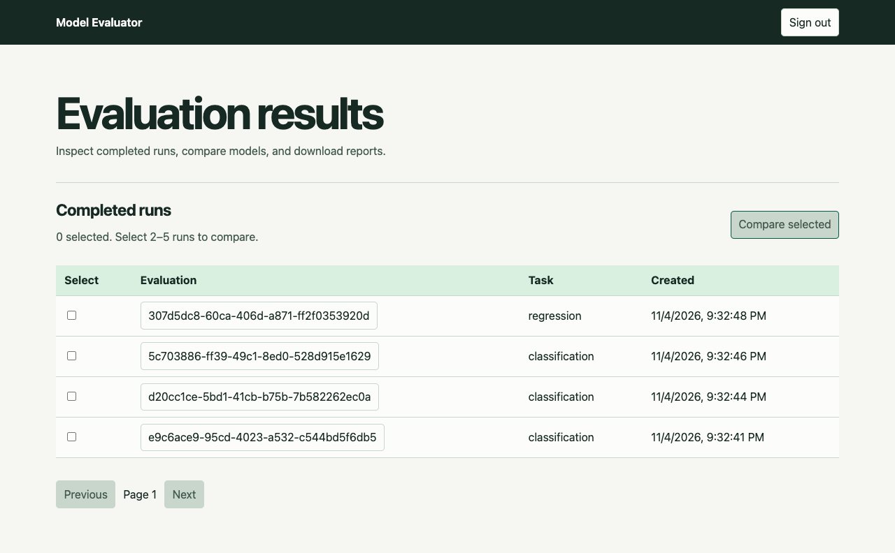
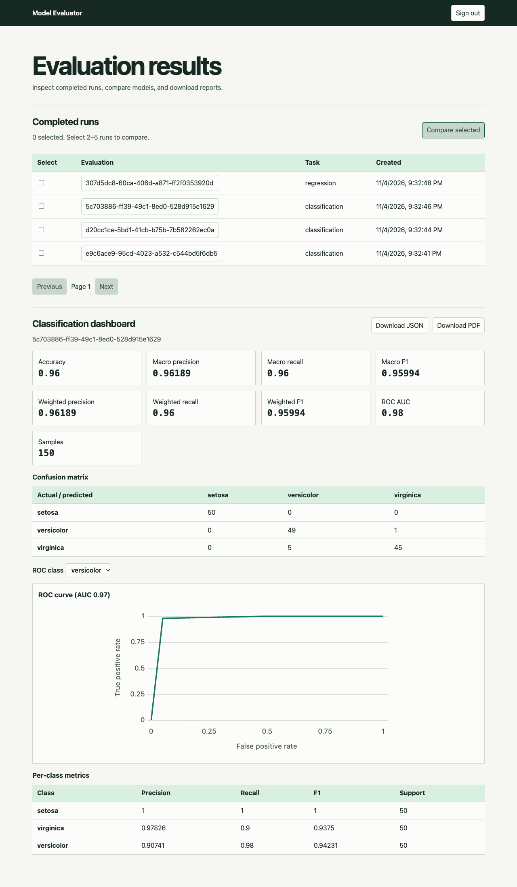
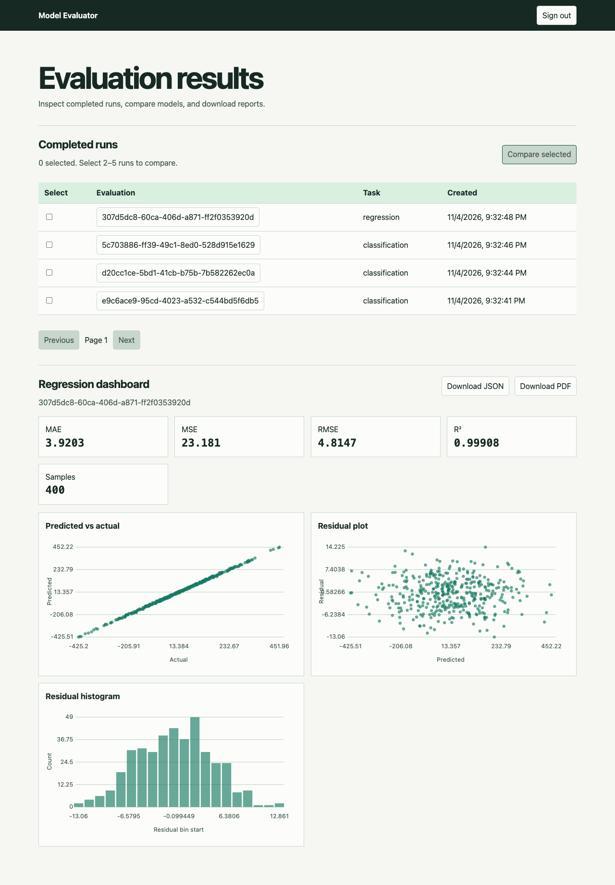
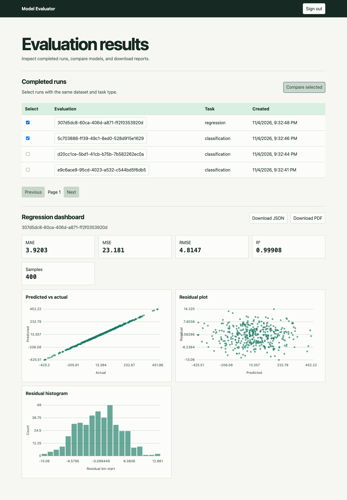
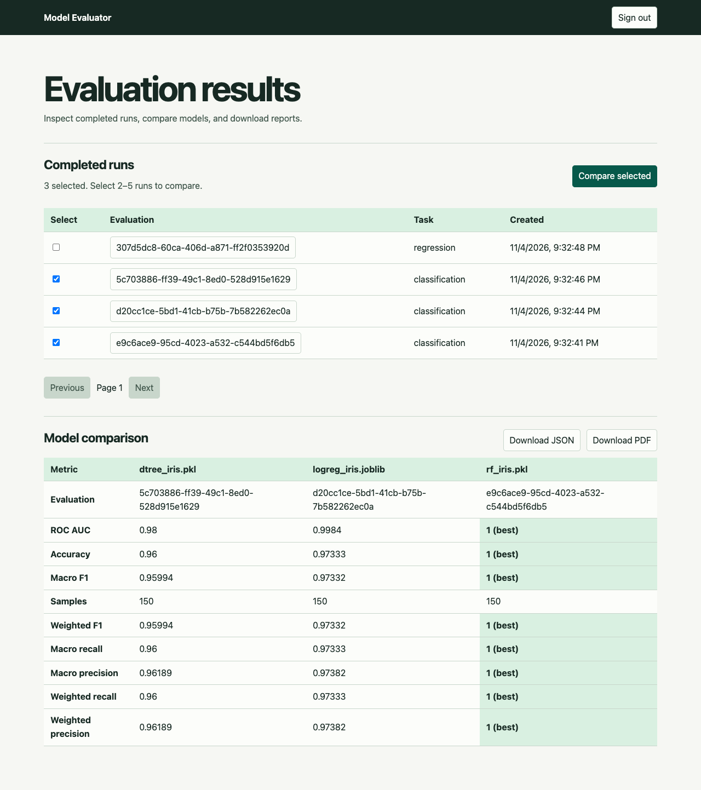
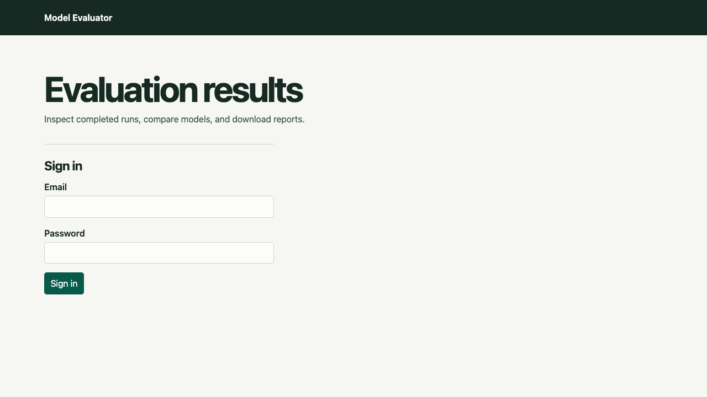

# Team 13 demo and evidence index

Current task allocation: [Team ownership](TEAM_OWNERSHIP.md). Primary owners are Anand (01-04, 19-20), Bidre (05-08, 17-18), Ayush (09-12, 21-22), Bhavesh (13-16, 23-24). Module support and historical authorship remain distinct.

Prepared by Bhavesh Velluru, 9 November 2026. Final source hashes: `evidence/final/source-manifest.json`; raw outputs retain their own execution revisions.

## Repository and contribution evidence
- [Repository and setup](../README.md)
- [Backlog and ownership](JIRA_BACKLOG.md)
- [PR #29 - sandboxed evaluation](https://github.com/bhaveshv24/Web-Based-ML-Model-Evaluator/pull/29)
- [PR #30 - results, comparison and reports](https://github.com/bhaveshv24/Web-Based-ML-Model-Evaluator/pull/30)
- [PR #31 - React and security work](https://github.com/bhaveshv24/Web-Based-ML-Model-Evaluator/pull/31)
- [PR #32 - retention and performance](https://github.com/bhaveshv24/Web-Based-ML-Model-Evaluator/pull/32)
- [PR #33 - validation and traceability](https://github.com/bhaveshv24/Web-Based-ML-Model-Evaluator/pull/33)
- [Commit history](https://github.com/bhaveshv24/Web-Based-ML-Model-Evaluator/commits/main/)

Review the author and review tabs of each PR for individual implementation and code-review evidence. The approved ownership table describes responsibilities, while GitHub supplies actual contribution records.

## CI snapshot
[Captured check statuses](evidence/tsmp-23/ci-checks-2026-11-09.json) identify the exact tested commit. The merge commit adds the main-branch merge relationship; later changes require their own checks. Statuses below are the captured outcomes, not future-run guarantees.

| Job | Captured result | Run |
| --- | --- | --- |
| tooling-cross-os (windows-latest) | success | [GitHub job](https://github.com/bhaveshv24/Web-Based-ML-Model-Evaluator/actions/runs/42598695842/job/129097555239) |
| core-tests | success | [GitHub job](https://github.com/bhaveshv24/Web-Based-ML-Model-Evaluator/actions/runs/42598695842/job/129097555140) |
| security-scan | success | [GitHub job](https://github.com/bhaveshv24/Web-Based-ML-Model-Evaluator/actions/runs/42598695842/job/129097555006) |
| tooling-cross-os (macos-latest) | success | [GitHub job](https://github.com/bhaveshv24/Web-Based-ML-Model-Evaluator/actions/runs/42598695842/job/129097554957) |
| sandbox-tests | success | [GitHub job](https://github.com/bhaveshv24/Web-Based-ML-Model-Evaluator/actions/runs/42598695842/job/129097554937) |
| compose-smoke | success | [GitHub job](https://github.com/bhaveshv24/Web-Based-ML-Model-Evaluator/actions/runs/42598695842/job/129097554836) |
| deployed-validation | success | [GitHub job](https://github.com/bhaveshv24/Web-Based-ML-Model-Evaluator/actions/runs/42598695712/job/129097553961) |
| tooling-cross-os (macos-latest) | success | [GitHub job](https://github.com/bhaveshv24/Web-Based-ML-Model-Evaluator/actions/runs/42598690035/job/129097536216) |
| core-tests | success | [GitHub job](https://github.com/bhaveshv24/Web-Based-ML-Model-Evaluator/actions/runs/42598690035/job/129097535975) |
| security-scan | success | [GitHub job](https://github.com/bhaveshv24/Web-Based-ML-Model-Evaluator/actions/runs/42598690035/job/129097535864) |
| compose-smoke | success | [GitHub job](https://github.com/bhaveshv24/Web-Based-ML-Model-Evaluator/actions/runs/42598690035/job/129097535804) |
| tooling-cross-os (windows-latest) | success | [GitHub job](https://github.com/bhaveshv24/Web-Based-ML-Model-Evaluator/actions/runs/42598690035/job/129097535730) |
| sandbox-tests | success | [GitHub job](https://github.com/bhaveshv24/Web-Based-ML-Model-Evaluator/actions/runs/42598690035/job/129097535531) |

GitGuardian previously flagged weak-password literals in two historical test commits. The integration fix generates those inputs at runtime. No new GitGuardian result was present in this snapshot unless listed above; review the current PR checks for its final status.

## Captioned product evidence
These captures belong to the earlier `/results` browser validation recorded in TSMP-21_TEST_EXECUTION_REPORT.md. They show that dashboard and its flows. Capture the new React routes during final rehearsal, with the tested commit and date in the recording notes.

Figure 1. Sign-in for the Django results dashboard.

Figure 2. Completed evaluation history available for dashboard inspection.

Figure 3. Classification metrics, confusion matrix and ROC visualization.

Figure 4. Regression metrics and prediction/residual visualizations.

Figure 5. Incompatible selection is blocked before comparison.

Figure 6. Compatible runs compared with best metric values highlighted.

Figure 7. Dashboard after sign-out.

## Fifteen-minute presentation and live demo
| Time | Slides | Presenter / activity |
| --- | --- | --- |
| 0:00-1:00 | 1-2 | Introduce Team 13, stakeholders and the repetitive evaluation problem |
| 1:00-3:00 | 3-4 | Explain scope, use cases and measurable requirements |
| 3:00-5:00 | 5-6 | Explain components, trust boundary and upload/evaluation sequence |
| 5:00-9:00 | 7-9 | Live demo of valid evaluation, negative input and comparison/export |
| 9:00-11:00 | 10 | Show actual backlog, PRs, contribution and CI evidence |
| 11:00-13:00 | 11 | Explain final passing tests, historical differences and remaining human/platform evidence |
| 13:00-14:00 | 12 | Maintenance, limitations and final acceptance actions |
| 14:00-15:00 | 13 | Questions and contribution discussion |

### Rehearsal setup
Use a disposable local Compose stack and supported fixtures trained with the pinned sandbox version. Configure fresh secrets from `.env.example`, make the sandbox directory accessible to UID 10002, then run `docker compose up --build -d`. Follow README prerequisites. A maintainer should create evaluator/admin accounts through the supported management path. Keep credentials out of screenshots and recordings.

Check frontend `http://localhost:5173`, Django `http://localhost:8000`, Redis, workers, beat and sandbox image readiness. Have at least two successful compatible evaluations for comparison, one regression result and a mismatched model/CSV pair. Existing system-test scripts generate fixture models; run them only against the disposable stack because recovery/retention cases alter state.

### Live sequence
1. Register and log in using the React frontend. Open Upload, submit a supported model and CSV and choose the target. Show a compatibility report, then submit evaluation and observe status/results.
2. Show classification metrics and the chart data produced for that run. Use the React results/history pages for charts, comparison and exports in the same session. The earlier `/results` dashboard is an optional historical surface.
3. Select compatible evaluations, show the winner direction and open JSON/PDF downloads. Show a mismatched selection and explain its rejection. Briefly inspect a regression dashboard.
4. Open history and a role-appropriate workspace. Show a representative owner-isolation check from the security evidence. Keep the privacy boundary visible without exposing another real user's data.
5. Show the actual GitHub CI run, one reviewed PR per functional area and the RTM. Explain any known policy or deployment gap from the defect register.

If an evaluation takes longer than the allotted demo time, show its actual status and switch to a clearly identified previously completed run. If the environment is unavailable, use the dated captures/recording and disclose the change in the demonstration.

## Remaining team evidence
- Record or link the required one-minute Sprint 1 and two-minute Sprint 2 videos; no tracked video was verified during this preparation.
- Record the final demo and new React registration/upload/status/history/workspace captures after rehearsal.
- Execute five-participant usability and remaining platform/browser checks. Availability already passed its defined five-minute local window.
- Final Part 3 reports and the RTM are generated and reconciled. Remote publication/CI remains pending under the no-push instruction.
- Review the reconstructed retrospectives, risk owners and proposed maintenance targets with the team.

## Final integrated React evidence - 9 November 2026

Current verification is in [the System Validation Report](SYSTEM_VALIDATION_REPORT.md),
[the four final report links and checklist](FINAL_SUBMISSION_CHECKLIST.md), and
[the source/design amendment](FINAL_SRS_SAD_STP_UPDATE.md).

- Figure 8. [React upload and compatibility](evidence/final/browser/ST-ING-01.png).
- Figure 9. [Completed real sandbox evaluation and charts](evidence/final/browser/ST-EXE-01.png).
- Figure 10. [React comparison and report export](evidence/final/browser/ST-REP-comparison.png).
- Figure 11. [Phone-width validation flow](evidence/final/browser/UI-responsive.png).

The earlier figures remain historical dashboard evidence. Use the current React flow
for the final demonstration. Updated test cases and all four required reports are now
in docs. Actual sprint video links, narrated final recording and team/participant review
remain team evidence listed in the final checklist.
